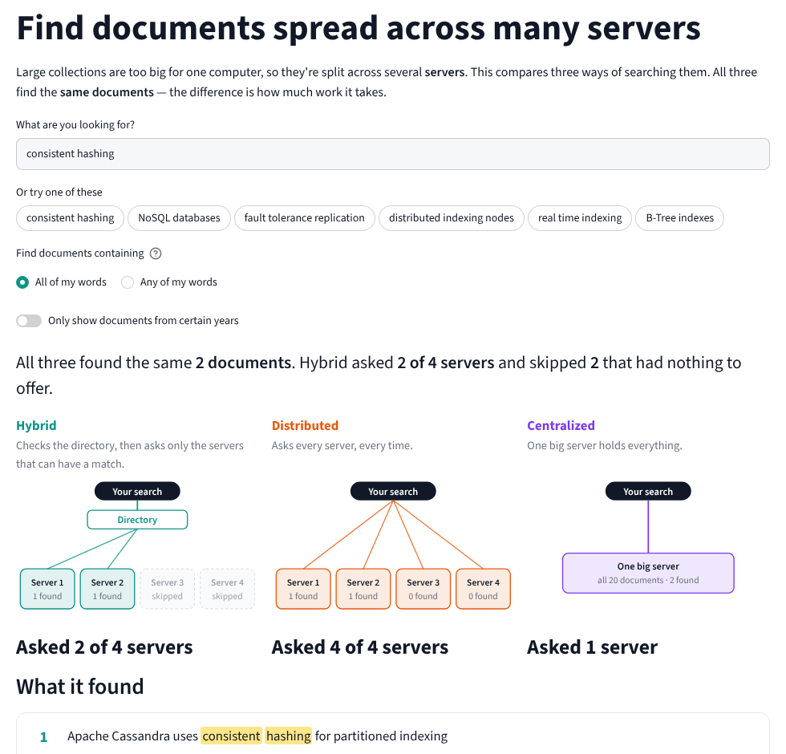

# Hybrid Indexing for Distributed Search

A small search engine that compares three ways of searching documents spread across several servers: one central index, a fully distributed index, and a hybrid of the two. Built for CS63016 (Big Data) at Kent State University.



## The idea

When a collection gets too big for one machine, you split it across servers. The question is what to do when someone searches.

- **Centralized:** keep one big index with everything. Simple, but it becomes the bottleneck.
- **Distributed:** split the documents across servers and send every search to every server. It scales, but most of those servers usually have nothing useful to say.
- **Hybrid:** split the documents across servers, and keep a small central directory that records which words live on which servers. A search checks the directory first and only contacts the servers that can actually have a match.

All three return the same results. What changes is how many servers each search has to contact, which on a real network is what costs time and money.

## What I found

I indexed 2,000 documents across 2 to 16 servers and ran 60 searches at each size.


| Approach | Servers contacted per search (16 servers) |
| --- | --- |
| Distributed | 16 |
| Hybrid, documents placed randomly | 11.5 |
| Hybrid, documents grouped by topic | 3.3 |

The interesting part is the middle row. The directory only helps if it can rule servers out, and with random placement almost every topic ends up on almost every server, so there's little to skip. Once documents on the same topic are kept on the same server, hybrid search contacts about 3 servers no matter how big the system gets, roughly 79% fewer than broadcasting to all 16.

I also checked that hybrid and centralized search return exactly the same ranked results for every test query, so the savings don't come at the cost of missing documents.

## How it works

1. **Tokenizing.** Text is lowercased and split into words. Hyphenated terms like `b-tree` and `real-time` stay whole, punctuation is dropped, and filler words like "the" are ignored.
2. **Inverted index on each server.** Each server keeps a map from every word to the documents that contain it, the same basic structure Lucene and Elasticsearch use.
3. **Central directory (metadata index).** Records which servers hold each word, plus collection-wide word counts. It doesn't store any documents, so it stays small.
4. **Routing.** A hybrid search asks the directory which servers have the query words and contacts only those, in parallel.
5. **Ranking with BM25.** Documents that contain more of the query words, and rarer words, rank higher. The directory supplies the collection-wide statistics so every server scores the same way, which is why all three approaches produce identical rankings.

Placement options:

- **By topic:** each topic gets a home server (the least loaded one when the topic first appears).
- **By hash:** documents are spread evenly by hashing their ID.

## Running it

You'll need Python 3.10 or newer.

```bash
git clone https://github.com/PiyushaKadam07/Big-data-Hybrid-Indexing.git
cd Big-data-Hybrid-Indexing
pip install -r requirements.txt
streamlit run app.py
```

### Searching real arXiv papers

The app can search a sample of real computer science papers from arXiv.

1. Download the [arXiv dataset from Kaggle](https://www.kaggle.com/datasets/Cornell-University/arxiv). You only need `arxiv-metadata-oai-snapshot.json`.
2. Make a sample of 20,000 computer science papers:

   ```bash
   python load_arxiv.py path/to/arxiv-metadata-oai-snapshot.json --size 20000
   ```

3. Start the app again. Choose **arXiv papers** in the sidebar. Each result links to the paper on arxiv.org.

Each paper's main arXiv category (machine learning, computer vision, databases and so on) is used as its topic for topic placement. Indexing 20,000 papers takes a few seconds and a few hundred MB of memory.

The app opens in your browser and has four pages:

- **Try a search:** type a query and see which servers each approach contacted, with the matching words highlighted in the results.
- **How it works:** a plain-language walkthrough.
- **What happens at scale:** reruns the experiment above on 500 to 5,000 documents.
- **Look inside the servers:** what each server holds, and which servers have a given word.

To run the tests:

```bash
pytest
```

## Project layout

```
hybrid_index.py        the search engine: servers, directory, routing, BM25
app.py                 the Streamlit app
dataset_generator.py   generates synthetic documents for the scale experiment
load_arxiv.py          makes a sample of computer science papers from the arXiv dataset
tests/                 tests for tokenizing, ranking, routing and identical results
assets/                screenshots used in this README
```

## Limitations

- Everything runs in one Python process. The "servers" are objects, not separate machines, so the app measures servers contacted rather than real network time.
- The scale experiment still uses generated documents. Running it on the arXiv sample is the next step.
- Topic placement assumes each document has a topic label. Real systems would need to cluster documents or route by category.

## Author

Piyusha Kadam
