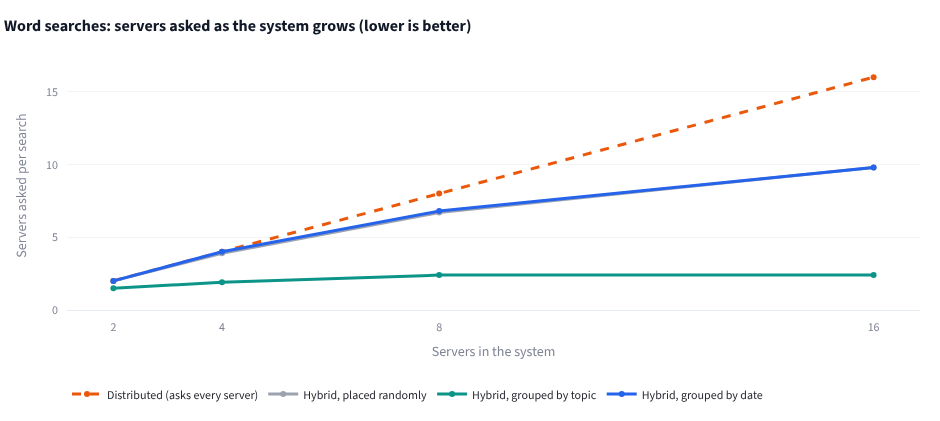
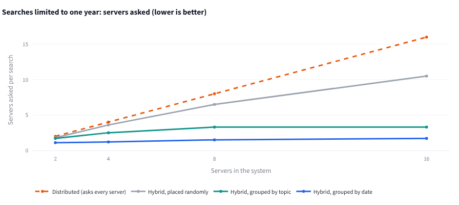

# Hybrid Indexing for Distributed Search

A small search engine that compares three ways of searching documents spread across several servers: one central index, a fully distributed index, and a hybrid of the two. Built for CS63016 (Big Data) at Kent State University.


## The idea

When a collection gets too big for one machine, you split it across servers. The question is what to do when someone searches.

- **Centralized:** keep one big index with everything. Simple, but it becomes the bottleneck.
- **Distributed:** split the documents across servers and send every search to every server. It scales, but most of those servers usually have nothing useful to say.
- **Hybrid:** split the documents across servers, and keep a small central directory that records which words (and which dates) live on which servers. A search checks the directory first and only contacts the servers that can actually have a match.

All three return the same results. What changes is how many servers each search has to contact, which on a real network is what costs time and money.

## What I found

I indexed 2,000 documents across 2 to 16 servers and ran the same 60 searches at each size, once as plain word searches and once limited to a single year. How much hybrid saves depends on how documents are placed on the servers:

- **Random:** documents are spread evenly by hashing their ID.
- **By topic:** each topic gets its own server.
- **By date:** each server holds a range of dates, like the volumes of an encyclopedia.

| Approach (16 servers) | Word search | Word search limited to one year |
| --- | --- | --- |
| Distributed | 16 | 16 |
| Hybrid, placed randomly | 11.5 | 10.5 |
| Hybrid, grouped by topic | **3.3** | 3.3 |
| Hybrid, grouped by date | 11.6 | **1.7** |





Each placement wins a different kind of search. The directory can only skip a server if it knows that server can't have a match. With random placement every topic and every year ends up on almost every server, so there's little to skip. Grouping by topic keeps word searches down to about 3 servers however big the system gets. Grouping by date does the same for searches limited to certain years, but helps plain word searches no more than random placement, because every topic shows up every year. The takeaway is to store data the way people search it.

I also checked that hybrid and centralized search return exactly the same ranked results for every test query, with and without a date limit, so the savings don't come at the cost of missing documents.

## How it works

1. **Tokenizing.** Text is lowercased and split into words. Hyphenated terms like `b-tree` and `real-time` stay whole, punctuation is dropped, and filler words like "the" are ignored.
2. **Inverted index on each server.** Each server keeps a map from every word to the documents that contain it, the same basic structure Lucene and Elasticsearch use.
3. **Central directory (metadata index).** Records which servers hold each word, plus collection-wide word counts. It doesn't store any documents, so it stays small.
4. **Routing.** A hybrid search asks the directory which servers have the query words, and hold documents from the requested dates if there's a date limit, then contacts only those, in parallel.
5. **Ranking with BM25.** Documents that contain more of the query words, and rarer words, rank higher. The directory supplies the collection-wide statistics so every server scores the same way, which is why all three approaches produce identical rankings.

Placement options:

- **By topic:** each topic gets a home server. The biggest topics are placed first, each on the server holding the fewest documents, so servers stay balanced even when topic sizes differ a lot.
- **By date (range placement):** the date boundaries are chosen from the data so every server holds about the same number of documents.
- **By hash:** documents are spread evenly by hashing their ID.

## Running it

You'll need Python 3.10 or newer.

```bash
git clone https://github.com/PiyushaKadam07/Big-data-Hybrid-Indexing.git
cd Big-data-Hybrid-Indexing
pip install -r requirements.txt
streamlit run app.py
```

### Searching real arXiv papers

The app can search a sample of real computer science papers from arXiv.

1. Download the [arXiv dataset from Kaggle](https://www.kaggle.com/datasets/Cornell-University/arxiv). You only need `arxiv-metadata-oai-snapshot.json`.
2. Make a sample of 20,000 computer science papers:

   ```bash
   python load_arxiv.py path/to/arxiv-metadata-oai-snapshot.json --size 20000
   ```

3. Start the app again. Choose **arXiv papers** in the sidebar. Each result links to the paper on arxiv.org.

Each paper's main arXiv category (machine learning, computer vision, databases and so on) is used as its topic for topic placement, and its submission month, read from the arXiv ID, is used for date placement and the year filter. Indexing 20,000 papers takes a few seconds and a few hundred MB of memory.

The app opens in your browser and has four pages:

- **Try a search:** type a query, optionally limit it to certain years, and see which servers each approach contacted, with the matching words highlighted in the results.
- **How it works:** a plain-language walkthrough.
- **What happens at scale:** reruns the experiment above on 500 to 5,000 documents.
- **Look inside the servers:** what each server holds, and which servers have a given word.

To run the tests:

```bash
pytest
```

## Project layout

```
hybrid_index.py        the search engine: servers, directory, routing, BM25
app.py                 the Streamlit app
dataset_generator.py   generates synthetic documents for the scale experiment
load_arxiv.py          makes a sample of computer science papers from the arXiv dataset
tests/                 tests for tokenizing, ranking, routing and identical results
assets/                screenshots used in this README
```

## Limitations

- Everything runs in one Python process. The "servers" are objects, not separate machines, so the app measures servers contacted rather than real network time.
- The scale experiment uses generated documents with example dates. Running it on the arXiv sample is the next step.
- The 20 sample sentences are given example dates so every placement works on them.
- Topic placement keeps a whole topic on one server. On arXiv, machine learning and computer vision are each about a fifth of all computer science papers, so with 8 or more servers those two servers end up larger than the rest. A real system would split very large topics across several servers.
- Topic placement assumes each document has a topic label. Real systems would need to cluster documents or route by category.

## Author

Piyusha Kadam
